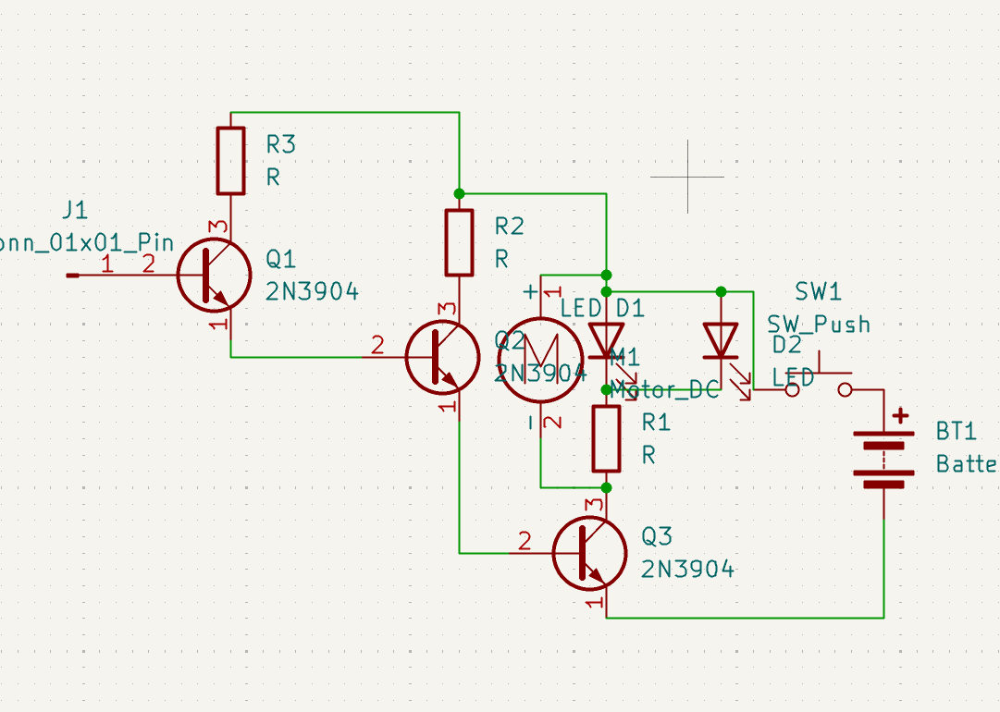
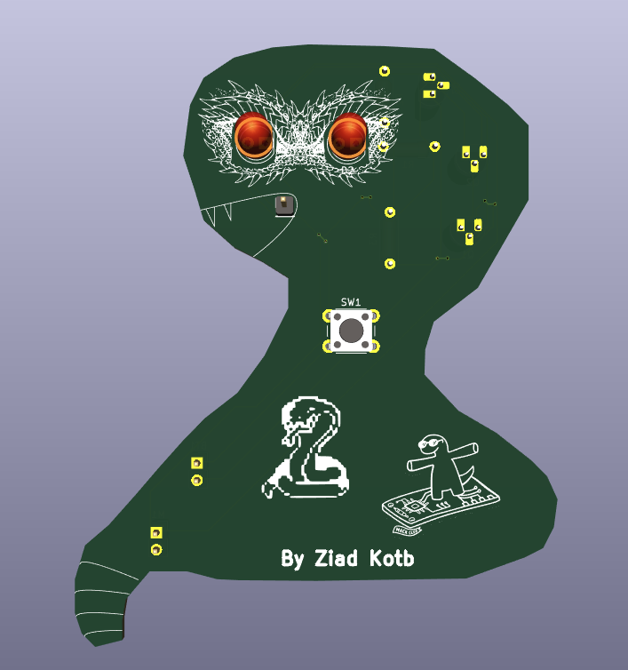
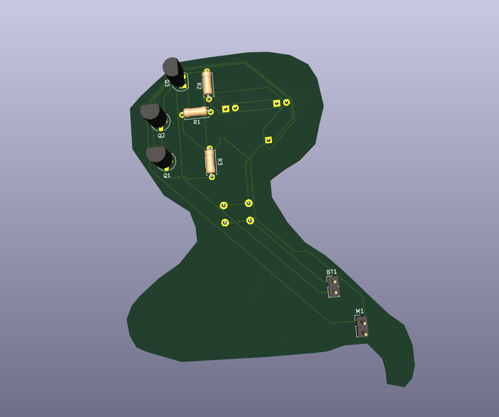

# Snake PCB

A snake-shaped detector board I designed in KiCad. The coil is its tongue, the two LEDs are its eyes, and a small vibration motor sits near the tail.

The circuit uses a coil and three NPN transistors to pick up a nearby signal and drive the LEDs and motor. I liked the idea of making the board shape part of the project instead of putting everything on a rectangle.

## Board and schematic

## 3D views

## Parts

| Part | Quantity |
| --- | --- |
| LED | 2 |
| 2N3904 NPN transistor | 3 |
| Mini vibration disc motor | 1 |
| 1 kΩ resistor | 1 |
| 330 Ω resistor | 1 |
| 1 MΩ resistor | 1 |
| 1×02 connector | 2 |
| Push button | 1 |

## Design files

- [KiCad project](badge.kicad_pro)
- [Schematic](badge.kicad_sch)
- [PCB layout](badge.kicad_pcb)
- [Gerber files](gerber%20files.zip)

Made by Ziad. My Hack Club Slack name is Ziad too.
